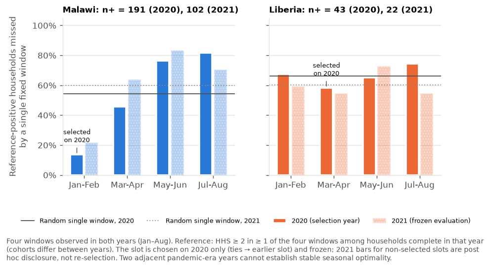
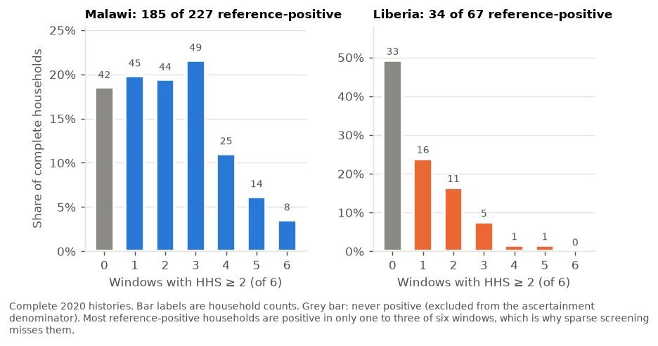
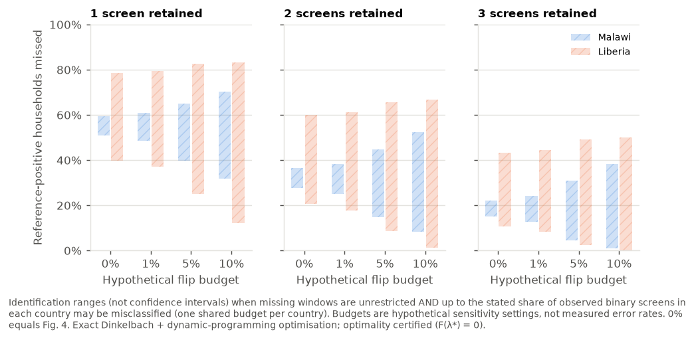
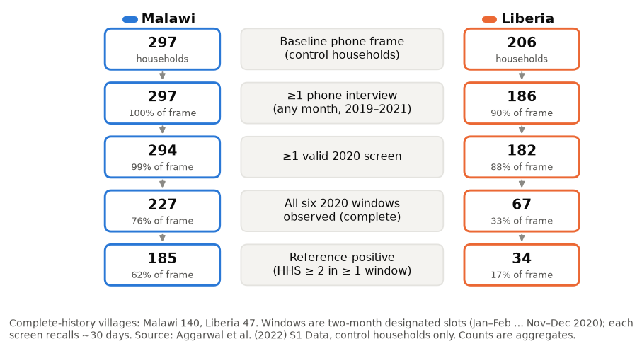
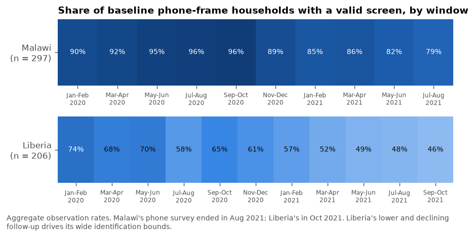

# Missed Household Hunger Under Infrequent Screening

**How many intermittently hungry households does a programme miss when it screens a fixed cohort less often, and does *when* it screens matter as much as *how often*? Evidence from rural Liberia and Malawi, 2020–2021.**

[](https://github.com/Isaac25-lgtm/household-hunger-screening/actions/workflows/ci.yml)


> **Research status:** independent reanalysis complete and reproducible; manuscript drafting approved *conditionally*; **not peer reviewed, not submitted**. See the [manuscript readiness verdict](reports/MANUSCRIPT_READINESS_VERDICT.md).

<p align="center">
  
</p>
<p align="center"><sub><b>Figure 2.</b> Expected share of reference-positive households (HHS ≥ 2 in ≥ 1 of six observed 30-day recall windows, complete 2020 histories) with no positive retained screen when <i>m</i> windows are kept at random. Bands and whiskers: 95% village-cluster bootstrap. <a href="figures/manuscript/fig2_frontier.svg">SVG</a> · <a href="figures/manuscript/fig2_frontier.pdf">PDF</a></sub></p>

> [!IMPORTANT]
> **What these results do *not* show.** They are **not** national or annual hunger prevalence, **not** an undercount of official statistics or IPC phases, **not** full-year incidence (six screens cover six ~30-day windows), and **not** the causal effect of interviewing less often (interviews were removed after the fact). The sample is the control arm of a cash-transfer study and is not nationally representative.

> [!NOTE]
> **External check, October 2026 (branch `investigation/strengthen-contribution`).**
>
> - **Data.** The timing question was re-examined in a second, independent Malawi panel, the World Bank High-Frequency Phone Survey 2020–2024. Its questions are different, so the results are aggregate-only and not pooled with this study's.
> - **Main finding.** A January–March contact beat a randomly timed contact in every comparison where those months were observed, in both panels.
> - **Caveats.** Choosing the month from a single earlier year failed when that year began at the pandemic onset. Small amounts of worst-case answer error could erase the advantage. None of these tests is blind.
> - **Details.** See [reports/investigation/](reports/investigation/README.md).

## Contents

- [Key findings](#key-findings)
- [The question and why it matters](#the-question-and-why-it-matters)
- [Data](#data)
- [How the analysis works](#how-the-analysis-works)
- [More results](#more-results)
- [Contribution relative to prior work](#contribution-relative-to-prior-work)
- [Limitations](#limitations)
- [Reproduce everything](#reproduce-everything)
- [Dashboard](#dashboard)
- [Repository layout](#repository-layout)
- [Validation](#validation)
- [Ethics, privacy and licensing](#ethics-privacy-and-licensing)
- [Reports](#reports)
- [Citation](#citation)

## Key findings

| | Malawi | Liberia |
|---|---|---|
| Baseline phone-frame households (villages) | 297 (150) | 206 (104) |
| Complete six-window 2020 histories | 227 (76%) | 67 (33%) |
| … of which reference-positive (HHS ≥ 2 in ≥ 1 window) | 185 | 34 |
| **Missed with 1 random screen** · *point (95% village bootstrap)* | **55.1%** (51.6–58.7) | **69.6%** (63.9–75.0) |
| Missed with 2 random screens | 31.9% (28.3–35.6) | 47.5% (40.2–54.4) |
| Missed with 3 random screens | 18.2% (15.2–21.4) | 30.7% (24.0–37.5) |
| **Identification range, 1 screen**, whole frame, missing windows unrestricted · *not a CI* | 50.8–59.3% | 39.8–78.6% |
| Same, plus up to 5% of observed labels wrong (hypothetical) · *not a CI* | 39.6–65.0% | 25.1–82.5% |
| Window chosen on 2020 data only | Jan–Feb | Mar–Apr |
| **2021 missed: frozen 2020 window vs random window** (95% bootstrap) | **21.6%** (13.7–30.5) vs 59.8% | 54.5% (31.6–77.3) vs 60.2% |
| 2021 difference, frozen − random | −38.2 pp (−46.9 to −29.2) | −5.7 pp (−26.9 to +14.1) |

**In one paragraph.** Hunger in these panels is intermittent: 75% (Malawi) and 94% (Liberia) of households that ever screened positive did so in only one to three of six windows. Screening fewer windows at random therefore misses many of them. In Malawi, though, *timing* dominates. A single lean-season (Jan–Feb) window chosen on 2020 data still missed only about one in five reference-positive households in 2021, against about three in five for a randomly placed window. Liberia's estimates are imprecise and weakly identified: only a third of households have complete histories, and its timing result is uninformative.

## The question and why it matters

Programmes that monitor a fixed cohort to find households needing follow-up must decide how often to interview them. The Household Hunger Scale (HHS) asks about the previous 30 days, so each interview observes a short window. If hunger comes and goes, fewer interviews mean more households are never caught in a positive window. This project quantifies that **ascertainment loss** exactly, bounds it when interviews are missing or labels may be wrong, and tests whether a calendar window chosen in one year keeps working in the next.

**Primary estimand.** For a complete household with *K* positive windows of *n* = 6, and *m* windows kept uniformly at random:

$$M_m=\frac{\sum_i \mathbf 1[K_i>0]\,\binom{6-K_i}{m}\big/\binom{6}{m}}{\sum_i \mathbf 1[K_i>0]}$$

It is conditional on the analysed households and the six observed windows. The random design is a benchmark; fixed and calendar schedules are analysed separately.

## Data

- **Source:** Aggarwal S, Jeong D, Kumar N, Park DS, Robinson J, Spearot A (2022). *COVID-19 market disruptions and food security: Evidence from households in rural Liberia and Malawi.* PLOS ONE 17(8): e0271488. [doi:10.1371/journal.pone.0271488](https://doi.org/10.1371/journal.pone.0271488). Supplement S1 Data ([doi:10.1371/journal.pone.0271488.s021](https://doi.org/10.1371/journal.pone.0271488.s021)), CC BY 4.0.
- **Files used:** `hhps_analysis_fullsample.dta` (4,744 phone interviews) and `baseline_analysis_fullsample.dta` (503 control households selected for the phone survey).
- **Provenance:** the archive is downloaded from PLOS by the pipeline and verified (9,098,158 bytes; SHA-256 `de2ae59d6190d70722b3aac33a9363e23ebea907ca639f7224bca2d9b11b66bb`).
- **Design:** households were called on alternating months, giving one designated interview per two-month window (Jan–Feb … Nov–Dec). Malawi fieldwork ran Jul 2019 – Aug 2021, Liberia Jan 2020 – Oct 2021.
- **Not in this repository:** record-level data. Only aggregate outputs are committed (enforced by [`scripts/check_release_safety.py`](scripts/check_release_safety.py)).

**This reanalysis vs the source article.** The source article estimated *average* food-security changes during COVID-19. This project asks a different measurement-design question of the same public data and estimates no treatment, cash-transfer or COVID effects.

## How the analysis works

<p align="center"></p>

| Question | Method | Uncertainty object | Validation |
|---|---|---|---|
| How many are missed with *m* of 6 screens? | Exact hypergeometric frontier (rational arithmetic) | 95% village-cluster percentile bootstrap (2,000 draws; stability-checked with 20,000) | Equals enumeration of every subset for every history up to *n* = 7 |
| What if missing interviews were anything? | Sharp bounds over all completions; exact prefix search (the denominator moves) | **Identification range** | Equals slot-level brute force (40 random instances) |
| What if some observed labels are wrong? | One shared flip budget per country; Dinkelbach + exact knapsack DP; certified optimum | **Hypothetical sensitivity envelope** | Brute force (25 instances × 4 budgets); nesting; 0% identity |
| Does a calendar window chosen in 2020 work in 2021? | Selection on 2020 only, frozen, evaluated in 2021 and matched households | Village bootstrap of evaluation and of the selection step | Tests fail if 2021 data reach selection |

**Why no machine learning?** The estimand is an exact design quantity, not a prediction target. A next-window risk model was considered and rejected (no decision rule to evaluate it against; 22 reference-positive Liberia test households). See [METHOD_SELECTION_AND_MODELS.md](reports/METHOD_SELECTION_AND_MODELS.md).

## More results

<table>
<tr>
<td width="50%"><br><sub><b>Fig 4.</b> Identification bounds over the whole frame (hatched; <b>not</b> confidence intervals) vs complete-history estimate ± 95% bootstrap. <a href="figures/manuscript/fig4_missing_bounds.pdf">PDF</a></sub></td>
<td width="50%"><br><sub><b>Fig 6.</b> Single fixed windows: 2020 selection vs frozen 2021 evaluation, with random-window benchmarks. <a href="figures/manuscript/fig6_timing.pdf">PDF</a></sub></td>
</tr>
<tr>
<td><br><sub><b>Fig 3.</b> Hunger is intermittent: most reference-positive households are positive in 1–3 of 6 windows.</sub></td>
<td><br><sub><b>Fig 5.</b> Ranges under hypothetical 0/1/5/10% label-error budgets (not estimated error rates).</sub></td>
</tr>
<tr>
<td><br><sub><b>Fig 1.</b> Cohort flow (aggregate counts).</sub></td>
<td><br><sub><b>Fig 8.</b> Follow-up by window: Liberia's attrition drives its wide bounds.</sub></td>
</tr>
</table>

All tables: [`tables/`](tables/) · figure ↔ data ↔ code map: [`reports/tables_figure_index.md`](reports/tables_figure_index.md) · machine-readable aggregates: [`data/public_aggregates/`](data/public_aggregates/).

## Contribution relative to prior work

The closest study is **Zhu, Gupta, Doan & Michuda (2026), *Food Security* 18(5):1509–1524** ([doi:10.1007/s12571-026-01699-w](https://doi.org/10.1007/s12571-026-01699-w)). Using weekly diaries from 305 Indian households, it shows that single-round surveys misclassify 15–48% of households against their annual average. **The general point that infrequent measurement misidentifies households is therefore not new**, and neither are the algorithms used here. This project adds, for an experiential 30-day indicator (HHS) in two African panels:

1. an explicit *ever-positive ascertainment* estimand and the full 1–6 screen frontier;
2. sharp no-assumption bounds for missing interviews and a shared-budget label-error sensitivity, both computed exactly;
3. a frozen out-of-year test showing that *timing* can matter as much as *frequency* (Malawi).

Other key references: Na et al. 2017 (*BMC Public Health*), Livings et al. 2023 (*Am J Prev Med*), Nord et al. 2002 (*J Nutr Educ Behav*), McDonough & Millimet 2024 (*AJAE*). Search method, head-to-head table and novelty verdict: [NOVELTY_AND_CLOSEST_WORK.md](reports/NOVELTY_AND_CLOSEST_WORK.md) · ledger: [literature_ledger.csv](reports/literature_ledger.csv).

## Limitations

- **Removing recorded interviews is not the same as conducting fewer.** Recall, panel conditioning and attrition could differ.
- **The reference is six observed windows, not the whole year.**
- **Selection into complete histories** is modest in Malawi (bounds ±4 pp) and severe in Liberia (bounds −30/+9 pp).
- **HHS is self-reported** and was validated for population prevalence, not household screening. Label error is analysed only hypothetically.
- **Two adjacent COVID-era years** cannot establish a stable seasonal optimum.
- **No cost data,** so no claim of an optimal or cost-effective frequency.

Full list with remediation: [LIMITATIONS_AND_THREATS.md](reports/LIMITATIONS_AND_THREATS.md).

## Reproduce everything

Windows PowerShell, from a folder of your choice:

```powershell
git clone https://github.com/Isaac25-lgtm/household-hunger-screening.git
cd household-hunger-screening
powershell -ExecutionPolicy Bypass -File scripts\bootstrap_environment.ps1   # .venv inside the project, pinned versions
powershell -ExecutionPolicy Bypass -File scripts\run_all.ps1                 # download + verify source, analysis, figures, tables, tests, safety audit
```

On any OS with Python ≥ 3.10:

```bash
python -m venv .venv && . .venv/bin/activate        # Windows: .venv\Scripts\activate
pip install -r requirements-lock.txt && pip install -e . --no-deps
python -m hunger_screening.cli all                  # writes data/public_aggregates, figures/, tables/
pytest
```

The pipeline is deterministic (fixed seeds; two consecutive runs give byte-identical CSVs) and takes under a minute. The source archive is fetched from PLOS into `data/raw/` (gitignored), and the run stops if its SHA-256 differs.

## Dashboard

An interactive Streamlit dashboard ([`dashboard/app.py`](dashboard/app.py)) presents the overview, cohort audit, frontier (with threshold switch), bounds, label-error sensitivity, timing, methods, limitations and aggregate downloads. It reads **only** the aggregate CSVs in `dashboard/data/`.

```powershell
powershell -ExecutionPolicy Bypass -File scripts\run_dashboard.ps1    # http://localhost:8501
```

**Public hosting:** not deployed yet (no hosted URL exists). The repository is deployment-ready for [Streamlit Community Cloud](https://share.streamlit.io): *New app → repository `Isaac25-lgtm/household-hunger-screening`, branch `main`, main file `dashboard/app.py`* (dependencies in `dashboard/requirements.txt`; no secrets required).

## Repository layout

```text
config/                 study.yaml (all parameters) · previous_findings.yaml (comparison only)
src/hunger_screening/   source_acquisition, provenance, schema_audit, build_panels, combinatorics,
                        estimands, cluster_bootstrap, missing_bounds, misclassification_bounds,
                        timing_validation, optional_diagnostics, pipeline, generate_figures,
                        generate_tables, cli
tests/                  134 tests (synthetic fixtures + brute-force checks + real-data checks when present)
data/public_aggregates/ aggregate, disclosure-checked outputs (CSV/JSON)
data/raw|interim/       source and household-level files: local only, gitignored
figures/                manuscript/ (PNG 300 dpi, SVG, PDF) · supplementary/ · README/
tables/                 manuscript tables (CSV + Markdown)
reports/                full report, audits, verdict, ledgers
dashboard/              Streamlit app + aggregate data
scripts/                bootstrap_environment.ps1 · run_all.ps1 · run_tests.ps1 · run_dashboard.ps1 · check_release_safety.py
```

## Validation

134 tests pass locally (0 failed, 0 skipped) with the source data present. In CI, the methods and public-aggregate regression tests run on synthetic fixtures and committed aggregates, and tests needing the private source are skipped. All 48 earlier exploratory quantities reproduce within prespecified tolerances. Details: [VALIDATION_AND_TEST_RESULTS.md](reports/VALIDATION_AND_TEST_RESULTS.md) · [REPRODUCTION_AUDIT.md](reports/REPRODUCTION_AUDIT.md).

## Ethics, privacy and licensing

- Secondary analysis of a public, de-identified supplement (CC BY 4.0). No new data were collected. Institutional review requirements for the manuscript are still to be confirmed.
- No household- or village-level identifiers, raw files or credentials are committed; an automated audit blocks them.
- **Code:** MIT ([LICENSE](LICENSE)). **Data:** remain under the source's CC BY 4.0 licence; please cite Aggarwal et al. (2022).

## Reports

| Report | Purpose |
|---|---|
| [FULL_SCIENTIFIC_ANALYSIS_REPORT.md](reports/FULL_SCIENTIFIC_ANALYSIS_REPORT.md) | Complete scientific write-up and IMRaD skeleton |
| [MANUSCRIPT_READINESS_VERDICT.md](reports/MANUSCRIPT_READINESS_VERDICT.md) | **CONDITIONAL GO** for drafting; not submission-ready; ranked blockers |
| [REPRODUCTION_AUDIT.md](reports/REPRODUCTION_AUDIT.md) | Earlier numbers vs independent recomputation |
| [DATA_QUALITY_AND_COHORT_FLOW.md](reports/DATA_QUALITY_AND_COHORT_FLOW.md) | Provenance, integrity checks, cohort, attrition |
| [METHOD_SELECTION_AND_MODELS.md](reports/METHOD_SELECTION_AND_MODELS.md) | Every method, proofs, diagnostics, no-ML justification |
| [NOVELTY_AND_CLOSEST_WORK.md](reports/NOVELTY_AND_CLOSEST_WORK.md) | Literature search, head-to-head comparison, verdict |
| [LIMITATIONS_AND_THREATS.md](reports/LIMITATIONS_AND_THREATS.md) | Threats and remediation |
| [CLAIM_EVIDENCE_LEDGER.csv](reports/CLAIM_EVIDENCE_LEDGER.csv) | Each claim → definition, numbers, uncertainty type, file, script, figure |
| [VALIDATION_AND_TEST_RESULTS.md](reports/VALIDATION_AND_TEST_RESULTS.md) | Test matrix with real statuses |
| [PROJECT_HANDOFF.md](reports/PROJECT_HANDOFF.md) | State, commit, next steps |

## Citation

Please cite the source study (Aggarwal et al. 2022, above) and this repository ([CITATION.cff](CITATION.cff)). Contact: via GitHub issues on this repository.
