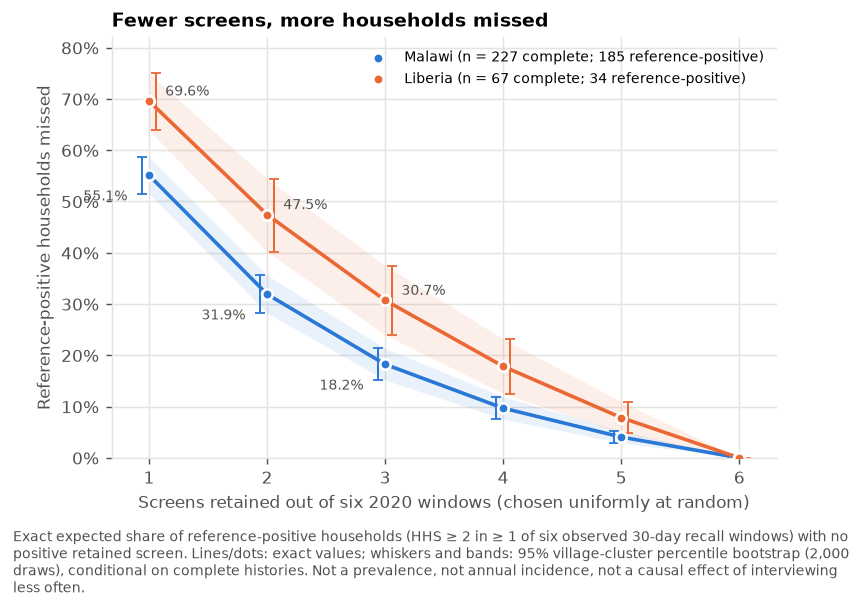
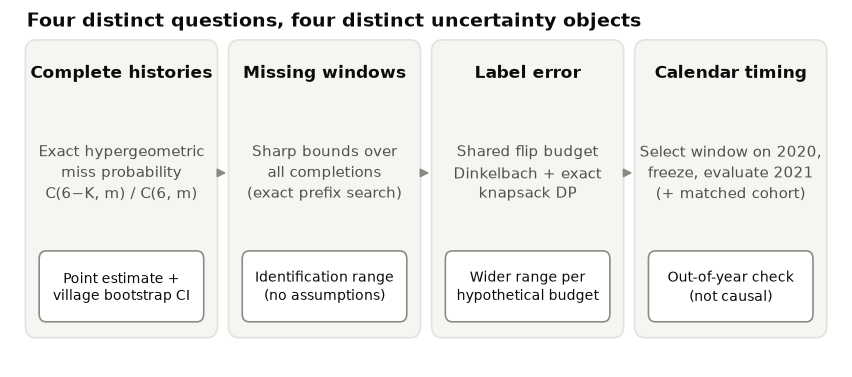
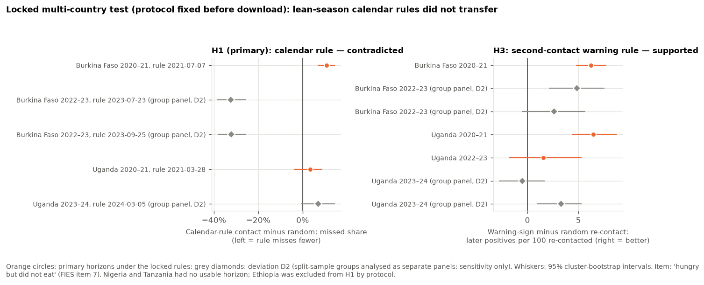
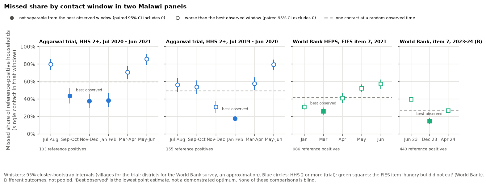
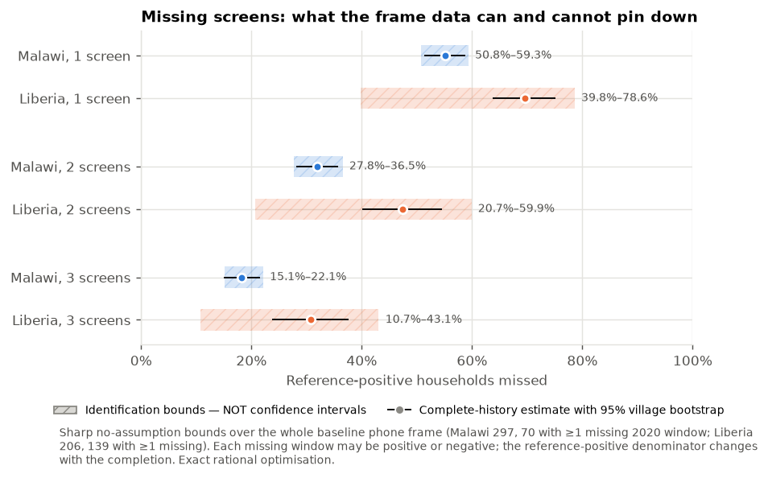
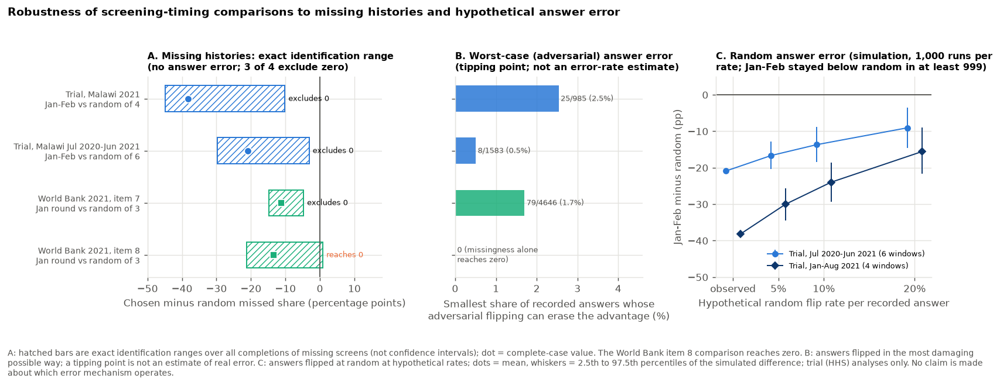

# Missed Household Hunger Under Infrequent Screening

**How many intermittently hungry households does a programme miss when it screens a fixed cohort less often, does *when* it screens matter as much as *how often*, and do timing rules travel between countries?**

**Data:**
- the control households of a rural trial in Liberia and Malawi (2019 to 2021);
- the World Bank Malawi High-Frequency Phone Survey (2020 to 2024);
- a test locked before any data were downloaded, in five further countries' World Bank phone surveys.

[](https://github.com/Isaac25-lgtm/household-hunger-screening/actions/workflows/ci.yml)


**Author:** Omoding Isaac, MSc Data Science and Analytics, Ministry of Health, Uganda. Co-researchers will be added.

> **Research status:** analysis complete and reproducible; external review addressed ([REVIEW_RESPONSE.md](reports/REVIEW_RESPONSE.md)); **not peer reviewed, not submitted**. The single-page summary of every finding is [ALL_FINDINGS.md](reports/ALL_FINDINGS.md).

<p align="center">
  
</p>
<p align="center"><sub><b>Figure 2.</b> Expected share of reference-positive households (HHS 2 or more in at least one of six observed 30-day recall windows, complete 2020 histories) with no positive retained screen when <i>m</i> windows are kept at random. Bands and whiskers: 95% village-cluster bootstrap. <a href="figures/manuscript/fig2_frontier.svg">SVG</a>, <a href="figures/manuscript/fig2_frontier.pdf">PDF</a></sub></p>

> [!IMPORTANT]
> **What these results do *not* show.**
> - They are **not** national or annual hunger prevalence.
> - They are **not** an undercount of official statistics or IPC phases.
> - They are **not** full-year incidence: six screens cover six roughly 30-day windows.
> - They are **not** the causal effect of interviewing less often, because interviews were removed after the fact.
>
> The trial sample is the control arm of a cash-transfer study and is not nationally representative.

## Contents

- [Key findings](#key-findings)
- [What each timing result is worth](#what-each-timing-result-is-worth)
- [The question and why it matters](#the-question-and-why-it-matters)
- [Data and measurement](#data-and-measurement)
- [How the analysis works](#how-the-analysis-works)
- [More results](#more-results)
- [Contribution relative to prior work](#contribution-relative-to-prior-work)
- [Limitations](#limitations)
- [Reproduce everything](#reproduce-everything)
- [Dashboard](#dashboard)
- [Repository layout](#repository-layout)
- [Validation](#validation)
- [Ethics, privacy, licensing and AI use](#ethics-privacy-licensing-and-ai-use)
- [Reports](#reports)
- [Citation](#citation)

## Key findings

**Frequency (trial data, complete 2020 histories, six two-month windows).** Brackets are 95% village bootstrap intervals; identification ranges are *not* confidence intervals.

| | Malawi | Liberia |
|---|---|---|
| Baseline phone-frame households (villages) | 297 (150) | 206 (104) |
| Complete six-window 2020 histories | 227 (76%) | 67 (33%) |
| Of which reference-positive (HHS 2 or more in at least 1 window) | 185 | 34 |
| **Missed with 1 random screen** | **55.1%** (51.6 to 58.7) | **69.6%** (63.9 to 75.0) |
| Missed with 2 random screens | 31.9% (28.3 to 35.6) | 47.5% (40.2 to 54.4) |
| Missed with 3 random screens | 18.2% (15.2 to 21.4) | 30.7% (24.0 to 37.5) |
| Identification range, 1 screen, missing windows unrestricted (all frame households) | 50.8 to 59.3% | 39.8 to 78.6% |
| Same, households with at least one observed 2020 window | 51.5 to 59.1% | 48.6 to 77.9% |

**Timing in Malawi (January-February window).** Each row states its reference period; rows with different references must not be compared directly.

| Analysis | Reference (windows) | Reference-positive households | January-February missed | Random window missed | Difference (95% CI) |
|---|---|---|---|---|---|
| In-sample, calendar 2020 | 6 | 185 | 17.8% | 55.1% | -37.3 (-43.6 to -30.6) |
| Chosen on 2020, tested 2021 | 4 (Jan to Aug 2021) | 102 | 21.6% | 59.8% | -38.2 (-46.9 to -29.2) |
| Chosen on Jul 2019 to Jun 2020, tested Jul 2020 to Jun 2021 | 6 | 133 | 38.3% | 59.3% | -20.9 (-27.5 to -13.6) |

**Beyond Malawi.**
- **Locked five-country test.** The protocol was committed before any data were downloaded. Contacting households in the FEWS NET lean season did **not** beat a randomly timed contact: Burkina Faso 2020-21 missed 10.9 points more (6.9 to 14.7); Uganda 2020-21 was inconclusive.
- **Second-contact rule.** Re-contacting first-contact negatives who answered "yes" to a milder hunger question found more hungry households than random re-contact in all 3 testable horizons, and in Malawi. Details: [11_MULTICOUNTRY_RESULTS.md](reports/investigation/11_MULTICOUNTRY_RESULTS.md).

**In one paragraph.**
- **Hunger is intermittent.** 75% (Malawi) and 94% (Liberia) of ever-positive households were positive in only one to three of six windows, so screening fewer windows misses many of them.
- **Timing mattered in Malawi.** A January-February contact did much better than a random one in every Malawi year observed, against four- and six-window references, in two independent Malawi panels, and under random answer error.
- **That advantage did not transfer.** As a lean-season calendar rule it failed in a locked test in other countries, where reported hunger fell round by round in 2020-21.
- **A simple second-contact rule did transfer.**

## What each timing result is worth

| Class | Examples |
|---|---|
| Exploratory, in-sample | 2020 window ranking; best 2020 pair (January-February + March-April, 6.5% missed: **not** headlined) |
| Out-of-time, not blind | 2020 to 2021 (21.6%); July-June test (38.3%); frozen best pair (November-December + January-February: 15.0% vs 36.4% for a random pair); World Bank Malawi transfer tests |
| Calendar-based sensitivity, not blind | FEWS NET lean-season window: Malawi beats random in every horizon; Liberia does not |
| Genuinely out-of-sample and prespecified | Five-country test only: calendar rule **contradicted**, second-contact rule **supported** |

## The question and why it matters

Programmes that monitor a fixed cohort to find households needing follow-up must decide how often, and when, to interview them. The Household Hunger Scale (HHS) asks about the previous 30 days, so each interview observes a short window. If hunger comes and goes, fewer interviews mean more households are never caught in a positive window.

This project:
- quantifies that ascertainment loss exactly;
- bounds it when interviews are missing or answers may be wrong;
- tests whether a window chosen in one year, or taken from a seasonal calendar, keeps working later and elsewhere.

**Primary estimand.** For a complete household with *K* positive windows of *n* = 6, and *m* windows kept uniformly at random:

$$M_m=\frac{\sum_i \mathbf 1[K_i>0]\,\binom{6-K_i}{m}\big/\binom{6}{m}}{\sum_i \mathbf 1[K_i>0]}$$

It is conditional on the analysed households and the six observed windows. The random design is a benchmark; fixed and calendar schedules are analysed separately.

## Data and measurement

- **Trial data:** Aggarwal S, Jeong D, Kumar N, Park DS, Robinson J, Spearot A (2022). *COVID-19 market disruptions and food security: Evidence from households in rural Liberia and Malawi.* PLOS ONE 17(8): e0271488. [doi:10.1371/journal.pone.0271488](https://doi.org/10.1371/journal.pone.0271488). Supplement S1 Data, CC BY 4.0.
  - Archive: 9,098,158 bytes; SHA-256 `de2ae59d6190d70722b3aac33a9363e23ebea907ca639f7224bca2d9b11b66bb`.
  - Households were called on alternating months: one designated interview per two-month window. Malawi fieldwork ran July 2019 to August 2021; Liberia January 2020 to October 2021.
- **HHS scoring (checked).** The supplied score is consistent with standard FANTA scoring (0, 1 or 2 per item by frequency; range 0 to 6), built from the standard items ("no food of any kind in the house", "went to sleep hungry", "a whole day and night without eating").
  - It equals the number of "yes" answers in 99.1% of records and exceeds it by the number of "often" answers otherwise.
  - The frequency answers themselves are not in the public supplement.
  - HHS 2 or more is the standard moderate-or-severe threshold. Here it is reached almost always through two or more experiences reported rarely or sometimes.
  - Details: [REVIEW_RESPONSE.md](reports/REVIEW_RESPONSE.md).
- **World Bank phone surveys:** Malawi 2020 to 2024 plus Burkina Faso, Ethiopia, Nigeria, Tanzania and Uganda (FIES items, 30-day recall; not the HHS). Citations and DOIs: [reports/investigation/README.md](reports/investigation/README.md).
- **Not in this repository:** record-level data. Only aggregate outputs are committed, enforced by [`scripts/check_release_safety.py`](scripts/check_release_safety.py).

## How the analysis works

<p align="center"></p>

| Question | Method | Uncertainty object |
|---|---|---|
| How many are missed with *m* of 6 screens? | Exact hypergeometric frontier | 95% village-cluster percentile bootstrap |
| What if missing interviews were anything? | Sharp bounds over all completions | Identification range |
| What if some answers are wrong? | Shared flip budget, solved exactly (Dinkelbach + knapsack); random-flip simulations | Hypothetical sensitivity envelope |
| Does a window chosen earlier work later? | Selection on earlier data only, frozen, evaluated later | Cluster bootstrap |
| Does a calendar rule travel? | Protocol locked before download, five countries | Cluster bootstrap; prespecified decision rule |

All exact solvers are checked against brute-force enumeration. No machine learning is used: a logistic model trained on earlier data did no better than a simple count rule ([METHOD_SELECTION_AND_MODELS.md](reports/METHOD_SELECTION_AND_MODELS.md)).

## More results

<table>
<tr>
<td width="50%"><br><sub><b>Fig I6.</b> Locked five-country test. <a href="figures/investigation/figI6_multicountry_locked_test.pdf">PDF</a></sub></td>
<td width="50%"><br><sub><b>Fig I1.</b> Timing in two Malawi panels. <a href="figures/investigation/figI1_timing_across_datasets.pdf">PDF</a></sub></td>
</tr>
<tr>
<td><br><sub><b>Fig 4.</b> Identification bounds (hatched; <b>not</b> confidence intervals). <a href="figures/manuscript/fig4_missing_bounds.pdf">PDF</a></sub></td>
<td><br><sub><b>Fig I3.</b> Robustness to missing interviews and worst-case answer error. <a href="figures/investigation/figI3_decision_robustness.pdf">PDF</a></sub></td>
</tr>
</table>

All tables are in [`tables/`](tables/); machine-readable aggregates are in [`data/public_aggregates/`](data/public_aggregates/).

## Contribution relative to prior work

**The general point that infrequent measurement misidentifies households is not new.**
- Zhu, Gupta, Doan & Michuda (2026), *Food Security* 18(5):1509-1524, [doi:10.1007/s12571-026-01699-w](https://doi.org/10.1007/s12571-026-01699-w).
- Wollburg, Markhof & Jolliffe (2025, conference draft).

**Lean-season data collection is already recommended in field guidance.**

**This project adds:**
1. exact ascertainment frontiers and bounds for an experiential 30-day indicator in two African panels;
2. out-of-time and calendar-based tests of timing in two Malawi panels;
3. a locked five-country test in which a calendar rule failed and a second-contact rule held.

Comparison table: [04_CLOSEST_PRIOR_WORK.md](reports/investigation/04_CLOSEST_PRIOR_WORK.md).

## Limitations

- **Removing recorded interviews is not the same as conducting fewer.** Recall, panel conditioning and attrition could differ.
- **The reference is the observed windows, not the whole year.** "Ever positive" grows with the number of windows.
- **Selection into complete histories** is modest in Malawi and severe in Liberia.
- **Answer error.** Small worst-case answer errors can reverse the timing rankings; random errors of up to 20% did not. Observed discordance between overlapping recall periods (24% and 10% for two FIES items) is not an error rate.
- **Single-window positives** (45 of 185 in Malawi) inflate the frontier. The timing result holds without them.
- **Survey round and calendar time cannot be separated,** including first-round and pandemic effects.
- **No cost data,** so no claim of an optimal or cost-effective schedule.

## Reproduce everything

Windows PowerShell, from a folder of your choice:

```powershell
git clone https://github.com/Isaac25-lgtm/household-hunger-screening.git
cd household-hunger-screening
powershell -ExecutionPolicy Bypass -File scripts\bootstrap_environment.ps1   # .venv inside the project, pinned versions
powershell -ExecutionPolicy Bypass -File scripts\run_all.ps1                 # download and verify source, analysis, figures, tables, tests, audit
```

On any OS with Python 3.10 or later:

```bash
python -m venv .venv && . .venv/bin/activate        # Windows: .venv\Scripts\activate
pip install -r requirements-lock.txt && pip install -e . --no-deps
python -m hunger_screening.cli all                  # trial-data analysis, figures, tables
python -m hunger_screening.cli investigation        # World Bank analyses (needs the archives, see below)
pytest
```

- **Trial data:** the archive is fetched from PLOS and the run stops if its SHA-256 differs.
- **World Bank archives:** need a free Microdata Library account. Place them as described in [reports/investigation/README.md](reports/investigation/README.md); they are never redistributed.
- **Determinism:** all outputs are byte-identical across runs.

## Dashboard

An interactive Streamlit dashboard ([`dashboard/app.py`](dashboard/app.py)) presents the trial-data results. It reads only the aggregate CSVs in `dashboard/data/`.

```powershell
powershell -ExecutionPolicy Bypass -File scripts\run_dashboard.ps1    # http://localhost:8501
```

It is not deployed publicly yet. It is ready for Streamlit Community Cloud (repository `Isaac25-lgtm/household-hunger-screening`, branch `main`, file `dashboard/app.py`; no secrets needed).

## Repository layout

```text
config/                 study.yaml, investigation.yaml, multicountry_protocol.yaml (locked)
src/hunger_screening/   pipeline and exact solvers; hfps.py, extensions.py, multicountry.py, review_responses.py
tests/                  176 tests (synthetic fixtures, brute-force checks, real-data checks when present)
data/public_aggregates/ aggregate outputs only (trial data; investigation/; multicountry/; review/)
data/raw, data/interim  source and household-level files: local only, gitignored
figures/                manuscript/, supplementary/, investigation/, README/
reports/                findings, review response, investigation reports, audits, ledgers
docs/                   development log
dashboard/              Streamlit app and aggregate data
scripts/                environment, run, test, dashboard and release-safety scripts
```

## Validation

- **Tests:** 176 pass locally with all data present. In CI, tests that need private data are skipped.
- **Earlier results:** all 48 earlier quantities reproduce.
- **Exact solvers:** match brute-force enumeration.
- **Locked protocol:** the multi-country protocol's SHA-256 is checked by the analysis run.

Details: [VALIDATION_AND_TEST_RESULTS.md](reports/VALIDATION_AND_TEST_RESULTS.md).

## Ethics, privacy, licensing and AI use

- **Ethics.** Secondary analysis of public, de-identified data; no new data were collected. An institutional ethics determination is still to be obtained.
- **Privacy.** No household or village identifiers, raw files or credentials are committed; an automated audit blocks them.
- **Licences.** Code: MIT ([LICENSE](LICENSE)). Trial data remain CC BY 4.0. World Bank data remain under the Microdata Library terms, and only aggregates are shared.
- **AI use (draft disclosure for the manuscript).** Analysis code, tests and report drafts were produced with the assistance of an AI coding assistant (Claude Code, Anthropic) under the author's direction. All results were checked against the source data, and the author takes responsibility for the content. A step log is in [docs/DEVELOPMENT_LOG.md](docs/DEVELOPMENT_LOG.md).

## Reports

| Report | Purpose |
|---|---|
| [ALL_FINDINGS.md](reports/ALL_FINDINGS.md) | Every finding in one place |
| [REVIEW_RESPONSE.md](reports/REVIEW_RESPONSE.md) | Point-by-point response to the external review, with evidence classes |
| [investigation/](reports/investigation/README.md) | World Bank replication, locked protocol and five-country results |
| [FULL_SCIENTIFIC_ANALYSIS_REPORT.md](reports/FULL_SCIENTIFIC_ANALYSIS_REPORT.md) | Original trial-data analysis |
| [MANUSCRIPT_READINESS_VERDICT.md](reports/MANUSCRIPT_READINESS_VERDICT.md) | Readiness and remaining blockers |
| [REPRODUCTION_AUDIT.md](reports/REPRODUCTION_AUDIT.md) | Earlier numbers against independent recomputation |
| [LIMITATIONS_AND_THREATS.md](reports/LIMITATIONS_AND_THREATS.md) | Threats and remediation |

## Citation

Please cite the source studies (Aggarwal et al. 2022 and the World Bank datasets) and this repository ([CITATION.cff](CITATION.cff)). Contact: Omoding Isaac, omodingisaac111@gmail.com.
